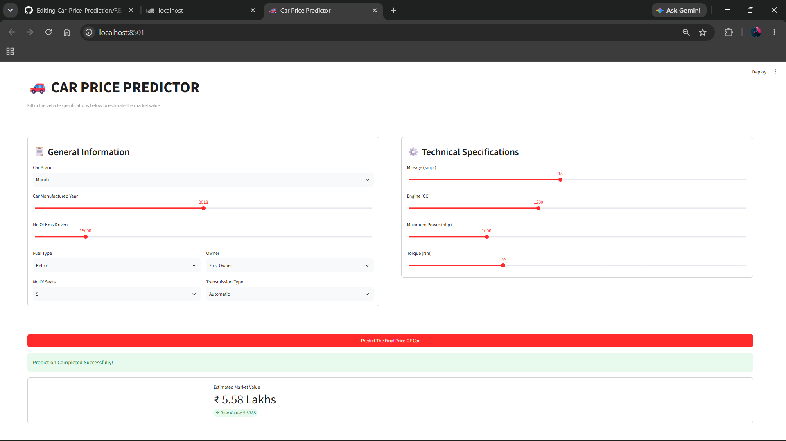

# 🚗 Car Price Prediction Web App

### 🔗 Live App Demo
👉 **[Click here to view the Live App](https://car-priceprediction-nrcb6appljiz3rrbrtvwza.streamlit.app)**
---


## 📝 Project Description
Buying or selling a used car often involves uncertainty regarding its actual market value. This project bridges that gap by leveraging a machine learning Linear Regression model trained on historical vehicle data. It features an interactive and user-friendly web interface built with Streamlit, enabling users to instantly estimate used car prices in Lakhs based on comprehensive vehicle specifications.


## ✨ Features
- **Interactive Web Interface:** Built using Streamlit containers, custom select boxes, and sliders for smooth user inputs.
- **Real-Time Price Estimation:** Instantly calculates and displays the predicted market value of the car.
- **Data Scaling & Processing:** Implements a pre-trained MinMaxScaler and scikit-learn pipeline for accurate feature handling.
- **Comprehensive Inputs:** Supports filters for brand name, manufacturing year, kilometers driven, fuel type, seats, ownership, transmission, mileage, engine capacity, maximum power, and torque.


## 💻 Technologies Used
- **Programming Language:** Python
- **Web Framework:** Streamlit
- **Machine Learning & Data Science:** Scikit-Learn, Pandas, NumPy
- **Model Serialization:** Pickle (`.pkl`)
- **Version Control:** Git & GitHub


## 📂 Project Structure
```text
Car_Price_Prediction/
│
├── car_price_app.py         # Main Streamlit web application file
├── car_price.ipynb          # Jupyter Notebook for data preprocessing & model training
├── carprice_charges.pkl     # Trained K-Nearest Neighbor file
├── scaler.pkl               # MinMaxScaler object for data normalization
├── requirements.txt         # Required Python packages for deployment
└── .gitattributes           # Git configuration for line endings
```

## 🔄 How It Works

```text
Car Price Prediction Pipeline/

User enters car details (Brand, Year, Km Driven, Fuel Type, etc.)
                   ↓
         Streamlit Frontend UI
                   ↓
         Python Backend Pipeline
                   ↓
          Data Preprocessing
                   ↓
   Feature Scaling (scaler.pkl)
                   ↓
Machine Learning Model (carprice_charges.pkl)
                   ↓
         Price Prediction
                   ↓
    Predicted Price displayed in Lakhs
```

## 🚀 Run the Project Locally


### 1. Clone the repository

```bash
git clone https://github.com/prathameshdeshpande1553/Car_Price_Prediction.git
```

### 2. Open the project

```bash
cd Car_Price_Prediction
```

### 3. Create a virtual environment
Windows:

```bash
python -m venv venv
```

Activate it:

```bash
venv\Scripts\activate
```

### 4. Install dependencies

```bash
pip install -r requirements.txt
```

### 5. Start the Streamlit Application

```bash
streamlit run car_price_app.py
```

## 🌐 Localhost

After starting the application, open the following address in your browser:

👉 [http://localhost:8501](http://localhost:8501)

You can also use:

👉 [http://127.0.0.1:8501](http://127.0.0.1:8501)

> **Note:** The localhost link works only when the application is running on your computer. It cannot be accessed by other people directly from your GitHub repository.


## 🧠 Machine Learning Model

The project uses a trained Linear Regression machine learning model to predict used car prices.

The model-related files are stored in the root directory:

```text
/
├── carprice_charges.pkl  # Trained K-Nearest Neighbor model
├── scaler.pkl           # MinMaxScaler for feature scaling
└── car_price.ipynb      # Jupyter Notebook used for training
```

## 📊 Dataset

The dataset used by the project is processed in:

```text
datasets/Car Dataset Processed.csv
```

## 📸 Screenshots
A quick preview of the Car Price Prediction web application interface:



## 🎯 Project Objectives
The main objectives of this project are:


• To build a machine learning model for accurate used car price prediction

• To understand data preprocessing, feature encoding, and feature scaling

• To integrate a machine learning model with an interactive Streamlit web interface

• To develop a simple, responsive UI for real-time model interaction

• To understand how machine learning models can be seamlessly deployed into web applications

## 🔮 Future Enhancements
- [ ] Deploying the application live on Streamlit Community Cloud for public access.
- [ ] Integrating advanced machine learning algorithms (like Random Forest or XGBoost) to compare accuracy.
- [ ] Adding more vehicle brands and multi-year historical trend charts.

## 👩‍💻 Author
Prathamesh Deshpande

GitHub: https://github.com/prathameshdeshpande1553

## ⭐ Support

Found this project helpful or inspiring? Drop a ⭐ on the repository to show your support and help others discover it!


